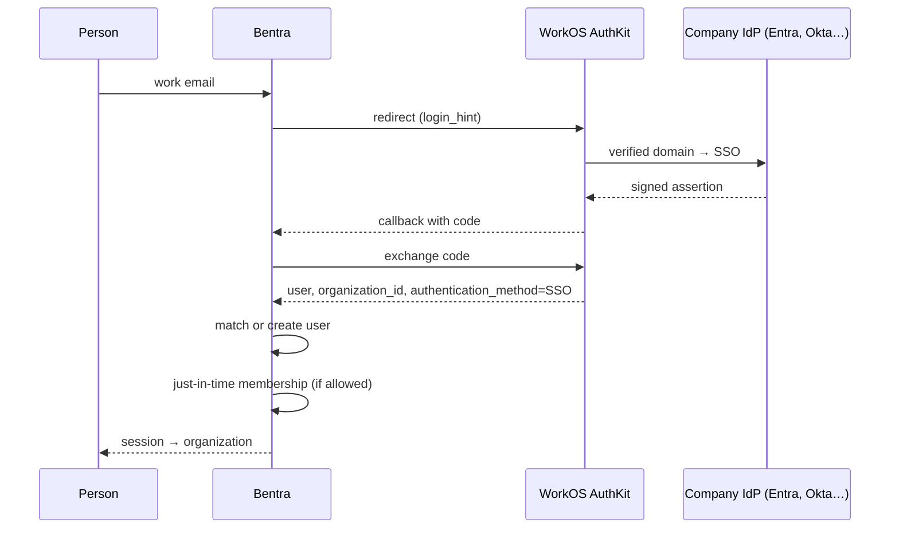

# How sign-in works

Bentra separates two questions:

- **Who are you?** That's authentication. WorkOS AuthKit answers it, with email and password, social login or your company's single sign-on (SSO).
- **What can you access?** That's authorization. Bentra answers it from your membership in an organization: your role there, your workspaces and your workflow roles.

Signing in through SSO never grants access on its own. A person needs a membership in the Bentra organization, either from an invitation or from the organization's [member provisioning](setup-sso.md#3-member-provisioning) setting.

## The sign-in flow

Bentra uses AuthKit's hosted sign-in page, then runs its own Django session:

1. On the Bentra login page, the person enters their work email.
2. Bentra sends them to AuthKit with that email as a hint. AuthKit decides how they sign in:
    - If the email's domain is a **verified domain** of an organization with SSO, AuthKit sends them straight to that organization's identity provider (IdP), such as Entra ID or Okta.
    - Otherwise they use email and password, or a social login.
3. AuthKit returns to Bentra's callback with a one-time code. Bentra exchanges the code and finds the Bentra user:
    - first by the stable WorkOS user id;
    - then by email, but only if WorkOS says the email is verified;
    - if neither matches, Bentra creates a new user.
4. If they signed in through an organization's SSO, Bentra may add them to that organization (just-in-time provisioning, below).
5. Bentra starts its own session. Organization roles and permissions apply from here, exactly as they do for password users.

## One SSO setup per organization

SSO belongs to a Bentra **organization**. Each organization that sets up SSO gets its own WorkOS organization, which holds:

- **SSO connections**: one or more identity providers. For example, Entra ID for `acme.com` and Okta for an acquired company.
- **Domains**: the email domains the organization has proven it owns, with a DNS TXT record.
- **Directory Sync** (SCIM) directories.

Bentra stores only the link between the two organizations and its own provisioning setting. Everything else is read live from WorkOS.

## Domains and the sign-in policy

Verified domains do two jobs:

1. **Routing.** AuthKit sends `someone@acme.com` to Acme's identity provider.
2. **Policy.** Once SSO is set up, WorkOS requires SSO for every email at those domains, so password sign-in stops for them.

People on other domains, such as contractors with `@consultant.com`, aren't affected. An admin invites them, and they sign in with email and password. If the organization's policy in WorkOS requires SSO for every member, contractors must be added to the company's IdP instead.

A domain must be proven with DNS before it's verified. Otherwise one organization could claim another company's domain and capture its employees' sign-ins. WorkOS also refuses consumer domains such as `gmail.com`.

## Just-in-time membership

When someone signs in through an organization's SSO and isn't a member yet, Bentra checks the organization's provisioning setting:

| Setting | Result |
|---|---|
| Don't add them (default) | No membership. They need an invitation. |
| Requester | They join as a requester and land in the request portal. |
| Member | They join as a member, with a seat in the default workspace. |

A membership is only created when all of these are true:

- the sign-in method was SSO;
- the email's domain is one of the organization's **verified** domains;
- the person isn't already a member. Existing members keep their role and are never downgraded.

Every join and every refusal is recorded as an authentication event.

## Who can set it up

- **Plan.** SSO is an Enterprise feature: the organization's license needs the `sso` feature (`has_feature(license, "sso")`). Self-hosted installs have every feature. For now, Bentra activates Enterprise from its side.
- **Permission.** Org admins and owners, through the `org.manage_settings` permission, manage SSO in **Settings → Authentication**. Other members see the page read-only. Requesters never see it.

Next: [Set up SSO](setup-sso.md) · [Internals](internals.md) · [API](../reference/api/sso.md)
