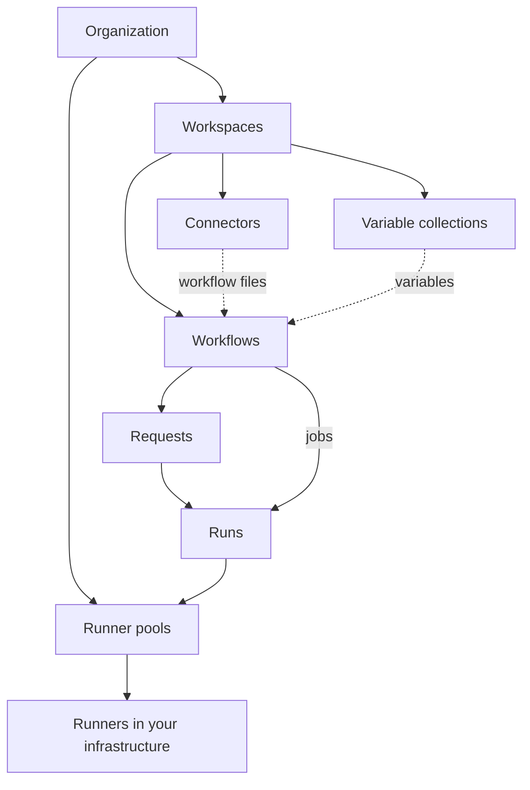

## Organization, account and plan

An **organization** is your company in Bentra. Everything else belongs to it, and nothing is shared between organizations. Each organization belongs to an **account** with a **plan**, which sets limits such as users, workflows and runs per month. See [Plans and limits](/plans).

## Members and organization roles

Every person in an organization has one organization role:

| Role | Can |
|---|---|
| Owner | Everything, including managing other owners. |
| Admin | Everything except the owner role. |
| Member | Create workspaces and workflows, and work in the workspaces they belong to. |
| Requester | Only the request portal: submit and follow their own requests, and approve where designated. Requesters don't take a seat. |

See [Members and groups](/guides/members-and-groups) and [Permissions](/guides/permissions).

## Workspaces

A **workspace** holds a team's workflows, forms, requests, runs, connectors and variable collections. People see the workspaces they belong to, each with a workspace role (owner, admin or member). Every organization has a **default workspace** that can't be deleted, and every member except requesters gets a seat in it. See [Create your first workflow](/get-started/first-workflow#create-a-workspace).

## Groups

A **group** is a named set of members. You can make a group a workflow's approver or give it a role on a workflow, and add its members to a workspace in one step. See [Members and groups](/guides/members-and-groups).

## Workflows

A **workflow** is a list of bash steps in `.bento/workflow/workflow.yml`. It has one of two types:

- **Request** (shown as **Form** in the UI): people fill in a form, the request is optionally approved, then it runs.
- **Job**: runs manually, from the API or on a schedule, with no form.

Its files come from a **GitHub repository** through a connector (the workflow tracks a branch or is pinned to a tag), or are **stored in Bentra**, where you edit a draft and publish numbered **versions**. Runs use the active published version. See [Workflow syntax](/reference/workflow-syntax) and [Bentra-stored workflows](/guides/bentra-stored-workflows).

## Forms

A request workflow's **form** is defined in `.bento/form/form.yml`. Bentra renders it, validates what people submit, and passes each answer to the steps as an environment variable. Forms appear in the **Forms** list of the workspace. See [Form syntax](/reference/form-syntax).

## Requests and approvals

Submitting a form creates a **request**. If the workflow requires approval, the request waits until enough **designated approvers** (people or groups) approve it, then it runs. Approvers can also reject it or request changes. See [Requests and approvals](/guides/requests-and-approvals).

## Runs and attempts

A **run** is one execution of a workflow, from an approved request or a job trigger. Each time a runner picks it up is an **attempt**; re-running a finished run adds an attempt. The run page shows each step's logs and checks. See [Runs](/guides/runs).

## Runners and runner pools

**Runners** are the processes that execute steps, hosted by you in a Kubernetes cluster, on a Docker host or on a Linux VM. They connect out to Bentra and only run what their **pool** is given. Every organization has a default pool, and each workflow can choose a pool. See [Install a runner](/runners/install).

## Connectors

A **connector** gives Bentra access to GitHub so it can read workflow files and hand runners a short-lived token to clone the repository. A connector is owned by a workspace and can be shared with others. See [Connect a repository](/get-started/connect-repository) and [Connectors](/reference/connectors).

## Variables and collections

**Variables** reach a workflow's steps as environment variables; secret values are write-only. A **variable collection** is a reusable set owned by a workspace that you attach to any number of workflows, and a workflow's own variables override it. See [Variables and secrets](/guides/variables-and-secrets).

## Job datasets

A job can publish small tables called **datasets**. Forms can use them for dropdown options, and other jobs can read them as inputs. See [Job datasets](/guides/job-datasets).

## Request portal

The **request portal** is a simple catalogue of forms for the whole organization. Requesters use only the portal; members can open it too. You choose which forms appear there and brand it with your logo. See [Request portal](/guides/request-portal).
