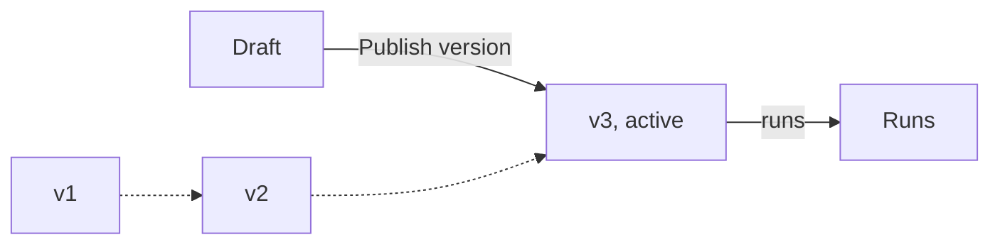

A workflow's files (`workflow.yml`, and `form.yml` for request workflows) live in one of two places. You choose when you create the workflow, on the **Where does this workflow live?** step:

| | Bentra-managed (stored in Bentra) | VCS-backed (Git repository) |
|---|---|---|
| Where files live | In Bentra | In a repository, read through a [connector](/reference/connectors) |
| How you edit them | The **Files** and **Form** tabs | Commits and pull requests in your repository. The **Form** tab can open a pull request for you. |
| What runs | The active published version | The tracked branch or the pinned tag |
| Good for | Getting started, small scripts, teams without a repository | Code review, CI and history in Git |

The storage choice is fixed once the workflow exists. See the [Workflow syntax](/reference/workflow-syntax) and [Form syntax](/reference/form-syntax) for what goes in the files.

## Bentra-stored workflows

A Bentra-stored workflow has a **draft**, the editable working copy, and **versions**, immutable snapshots published from the draft. New requests and job runs use the **active version**. A submitted request keeps the version it was submitted against, so publishing doesn't change what an already-submitted request runs. Editing the draft changes nothing until you publish.



### Starter files

A new Bentra-stored workflow starts with starter files and a published v1, so it can run straight away:

- `workflow.yml`: one step that prints a greeting.
- `requirements.txt`: empty. Python packages listed here are installed before your steps run.
- `form.yml` (request workflows only): one text input.

The files sit at the top level of the file set. `workflow.yml` and `form.yml` are required and can't be deleted. A `README.md` is optional.

### Edit files

Open the workflow's **Files** tab. It's a code editor with a file tree on the left.

- Click a file to open it. Click **Save** to save your change to the draft.
- Click **+** (**New file**) next to **Files** and enter a **File path**, such as `scripts/deploy.sh`.
- The version selector in the toolbar shows **Draft** when you're editing. Pick a version to view its files read-only; the active one is marked **Active · runs on trigger**. Switch back to **Draft** to edit.

The draft has size limits; see [About YAML syntax for workflows](/reference/workflow-syntax#about-yaml-syntax-for-workflows).

<Warning>
Keep secrets in [variables](/guides/variables-and-secrets), not in files. Anyone who can view the workflow can read its files.
</Warning>

### Publish a version

<Steps>
<Step title="Save your changes">
Save every file you changed. Publishing snapshots the saved draft.
</Step>
<Step title="Click Publish version">
On the **Files** tab, click **Publish version**. Add an optional **Label**, such as `add retry handling`, and confirm.
</Step>
<Step title="It becomes active">
The new version gets the next number and becomes the active version immediately. New requests and job runs use it; requests already submitted keep their version until the submitter updates their answers.
</Step>
</Steps>

Bentra checks the draft before publishing and refuses a version that couldn't run:

- `workflow.yml` must be valid YAML and a mapping. Everything else in it is checked by the runner when a run starts.
- A request workflow's `form.yml` must pass form validation, including any dataset dropdowns (`options_from`) it uses. See [Job datasets](/guides/job-datasets).

You can save a broken draft. You just can't publish it.

**Settings → Source** summarizes the workflow's storage: the **Active Version**, how many **Published Versions** exist, and when the **Draft** was last updated.

### Roll back to an earlier version

Rolling back makes an earlier version the active one again. The draft isn't changed.

Activating a version is done through the API or the MCP server: [`POST workflows/{id}/versions/{version_id}/activate/`](/reference/api/files#versions) or the `activate_version` tool. To roll back in the UI instead, open the old version from the version selector, copy its content into the draft, and publish it as a new version.

Each run records which version it used. See the **Details** panel on the [run page](/guides/runs).

## Edit a form in Bentra

Request workflows have a **Form** tab with a YAML editor and a live preview side by side. It works for both storage types; only saving differs.

- **Left:** the `form.yml` editor. The panel under it lists validation problems with their line numbers, such as an unknown property, a missing required key or a misspelled field type, often with a "did you mean" suggestion. It reads **No problems** when the form is valid.
- **Right:** **Preview** renders the form exactly as people will see it, updating as you type. **Payload** shows the submission it would produce with default values.
- **Copy YAML** copies the editor content.

You need the workflow's **Manage form settings** permission (workflow Admins and Editors) to edit. Others see the rendered form read-only.

<Tabs>
<Tab title="Bentra-stored">

Click **Save**. This updates `form.yml` in the draft. The change goes live when you [publish a version](#publish-a-version).

</Tab>
<Tab title="Repo-backed">

Click **Open PR**. In **Open a pull request**, enter a **Branch name** and a **Commit message**, then click **Open PR**.

Bentra creates the branch from the workflow's tracked branch (or the repository's default branch for a tag-pinned workflow), commits the form file and opens a pull request. The dialog links to it. Only the form file is committed.

The form changes when the pull request is merged and, for a tag-pinned workflow, when you pin a new tag. If the form has validation problems, the dialog warns you before opening the pull request.

</Tab>
</Tabs>

The same operations are available through the API: [`GET` and `PUT workflows/{id}/form/`](/reference/api/workflows).

## Repo-backed workflows

A repo-backed workflow reads its files from a repository through a VCS connector. Connect a repository first: see [Connect a repository](/get-started/connect-repository) and [Connectors](/reference/connectors).

Configure the source in **Settings → Source**:

| Setting | Meaning |
|---|---|
| **VCS Connection** | The connector Bentra uses to read the repository. |
| **Repository** | The connected repository. Many workflows can use the same repository. |
| **Tracking Mode** | **Branch**, **Tag** or **Tag pattern**. See below. |
| **Branch** / **Tag** | The branch to track, the tag to pin, or the tag pattern to follow. |
| **Working Directory** | The folder that holds this workflow's files, for example `inventory`. Steps start there. Empty means the repository root. |

The working directory is the only path you set. You can also set it when you create the workflow, with the API (`source.working_directory`) or with the MCP server (`working_directory` on `create_workflow` and `update_workflow`).

### Working directory and file names

Bentra finds the workflow's files by name in the working directory:

| File | Accepted names | Needed |
|---|---|---|
| Workflow | `workflow.yml`, `workflow.yaml`, `WORKFLOW.yml`, `WORKFLOW.yaml` | Always |
| Form | `form.yml`, `form.yaml`, `FORM.yml`, `FORM.yaml` | Request workflows. Ignored for jobs. |
| README | `README.md`, `readme.md` | Optional |

Several workflows can share one repository, each with its own working directory:

```text
inventory/
  workflow.yml
  form.yml
  README.md
release/
  workflow.yml
  form.yml
tools/
  common.sh
```

Here one workflow has the working directory `inventory` and another has `release`.

Steps start in the working directory, and the run has the whole repository, so a step in `inventory/` can run `../tools/common.sh`. `bento_inputs.json` and `bento.env` are written to the working directory, and the dependency install reads `requirements.txt` or `package.json` from it.

This needs runner **0.13.2** or later (0.13.0 and 0.13.1 were never published). Older runners are refused with **426 Upgrade Required**; see [Install a runner](/runners/install#versions).

### Sync errors

A sync fails if Bentra can't find the files. The version published before keeps running, and **Settings → Source** shows the error.

| Error | Fix |
|---|---|
| `The working directory 'x' isn't in the repository.` | Correct **Working Directory**, or add the folder on the tracked branch or tag. |
| `No workflow.yml or workflow.yaml in the working directory 'inventory'.` (or `... in the repository root.`) | Add the file to the working directory under one of the accepted names. The same applies to `form.yml` on a request workflow. |
| `inventory/form.yml and inventory/form.yaml are both present. Keep one of them.` | Delete one of the two files. |

After fixing it, push the commit or click **Sync from repo**.

### Moving from .bento/ paths

Earlier, Bentra read `.bento/workflow/workflow.yml` and `.bento/form/form.yml`, or other paths you set per workflow. Those path settings are gone, and a repository that still keeps its files under `.bento/` fails its next sync until they're moved. The version published before keeps running in the meantime.

<Steps>
<Step title="Move the files">
Move the workflow file, the form file and the README into the workflow's folder, named `workflow.yml`, `form.yml` and `README.md` (or another accepted name). For a repository with one workflow, the repository root works.
</Step>
<Step title="Set the working directory">
In **Settings → Source**, set **Working Directory** to that folder. Leave it empty for the repository root.
</Step>
<Step title="Sync">
Push the commit, then click **Sync from repo**.
</Step>
</Steps>

Steps now start in the working directory, so check the relative paths in your `run` scripts.

Bentra-stored workflows created with files under `.bento/` aren't converted. Create the workflow again; the new one starts with `workflow.yml` and `form.yml` at the top level.

### Published versions

A repository workflow runs a **published version**: Bentra's own copy of the repository at one commit. It doesn't read the repository when a form opens or a run starts. Runs keep working while GitHub is unavailable, and a request runs the commit it was submitted against, even if new commits land before it's approved.

Bentra publishes a new version when:

- the workflow is created (v1),
- you change its source settings,
- you click **Sync from repo** under **Settings → Source**,
- GitHub sends a push for the tracked branch or tag, if the connector's [push webhook](/get-started/connect-repository#set-up-the-push-webhook) is set up.

A sync of an unchanged commit publishes nothing, and a failed sync leaves the current version running. **Settings → Source** shows the published version and its commit, the last sync and any error.

- **Track a branch** to publish each new commit on it.
- **Pin a tag** to publish what the tag points at. If someone moves the tag, the new commit is published and the version is labelled with the commit the tag moved from.
- **Follow a tag pattern** such as `v*` to publish the newest release: the highest semantic version among matching tags (`v1.10.0` beats `v1.9.9`). Pre-releases like `v2.0.0-rc.1` count only if the pattern contains a `-`. Deleting the newest tag never rolls back to an older one.

To roll back, activate an older version with the API or MCP (`activate_version`). Automatic syncs then stop, so the next push doesn't undo the rollback. Activating the newest version turns them back on.

A snapshot holds the whole repository, not only the working directory: up to 2,000 files, 10 MB per file and 50 MB in total (20 MB as a compressed archive). Steps that download more at run time still need the network, for example Terraform registry modules, `pip install` and GitHub Actions steps.

You can also change the branch or tag through the API with `PATCH workflows/{id}/` (`source.branch` or `source.tag`). See the [Workflows API](/reference/api/workflows).

## API and MCP

Everything on this page can be done with the API or the [MCP server](/ai/mcp-server):

- Files and versions of Bentra-stored workflows: [Files and versions](/reference/api/files).
- Creating workflows, changing the source and editing forms: [Workflows](/reference/api/workflows).
