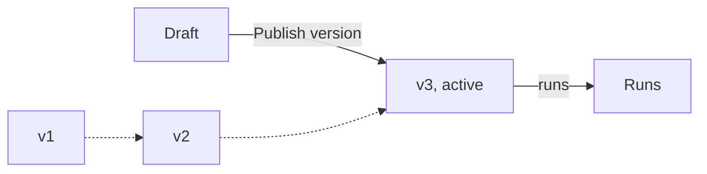

A workflow's files (`.bento/workflow/workflow.yml`, and `.bento/form/form.yml` for request workflows) live in one of two places. You choose when you create the workflow, on the **Where does this workflow live?** step:

| | Bentra-managed (stored in Bentra) | VCS-backed (Git repository) |
|---|---|---|
| Where files live | In Bentra | In a repository, read through a [connector](/reference/connectors) |
| How you edit them | The **Files** and **Form** tabs | Commits and pull requests in your repository. The **Form** tab can open a pull request for you. |
| What runs | The active published version | The tracked branch or the pinned tag |
| Good for | Getting started, small scripts, teams without a repository | Code review, CI and history in Git |

The storage choice is fixed once the workflow exists. See the [Workflow syntax](/reference/workflow-syntax) and [Form syntax](/reference/form-syntax) for what goes in the files.

## Bentra-stored workflows

A Bentra-stored workflow has a **draft**, the editable working copy, and **versions**, immutable snapshots published from the draft. Runs always use the **active version**. Editing the draft changes nothing until you publish.

### Starter files

A new Bentra-stored workflow starts with starter files and a published v1, so it can run straight away:

- `.bento/workflow/workflow.yml`: one step that prints a greeting.
- `requirements.txt`: empty. Python packages listed here are installed before your steps run.
- `.bento/form/form.yml` (request workflows only): one text input.

`workflow.yml` and `form.yml` are required and can't be deleted.

### Edit files

Open the workflow's **Files** tab. It's a code editor with a file tree on the left.

- Click a file to open it. Click **Save** to save your change to the draft.
- Click **+** (**New file**) next to **Files** and enter a **File path**, such as `scripts/deploy.sh`.
- The version selector in the toolbar shows **Draft** when you're editing. Pick a version to view its files read-only; the active one is marked **Active · runs on trigger**. Switch back to **Draft** to edit.

The draft has size limits; see [About YAML syntax for workflows](/reference/workflow-syntax#about-yaml-syntax-for-workflows).

<Warning>
Keep secrets in [variables](/guides/variables-and-secrets), not in files. Anyone who can view the workflow can read its files.
</Warning>

### Publish a version

<Steps>
<Step title="Save your changes">
Save every file you changed. Publishing snapshots the saved draft.
</Step>
<Step title="Click Publish version">
On the **Files** tab, click **Publish version**. Add an optional **Label**, such as `add retry handling`, and confirm.
</Step>
<Step title="It becomes active">
The new version gets the next number and becomes the active version immediately. The next run uses it.
</Step>
</Steps>

Bentra checks the draft before publishing and refuses a version that couldn't run:

- `workflow.yml` must be valid YAML and a mapping. Everything else in it is checked by the runner when a run starts.
- A request workflow's `form.yml` must pass form validation, including any dataset dropdowns (`options_from`) it uses. See [Job datasets](/guides/job-datasets).

You can save a broken draft. You just can't publish it.

**Settings → Source** summarizes the workflow's storage: the **Active Version**, how many **Published Versions** exist, and when the **Draft** was last updated.

### Roll back to an earlier version

Rolling back makes an earlier version the active one again. The draft isn't changed.

Activating a version is done through the API or the MCP server: [`POST workflows/{id}/versions/{version_id}/activate/`](/reference/api/files#versions) or the `activate_version` tool. To roll back in the UI instead, open the old version from the version selector, copy its content into the draft, and publish it as a new version.

Each run records which version it used. See the **Details** panel on the [run page](/guides/runs).

## Edit a form in Bentra

Request workflows have a **Form** tab with a YAML editor and a live preview side by side. It works for both storage types; only saving differs.

- **Left:** the `form.yml` editor. The panel under it lists validation problems with their line numbers, such as an unknown property, a missing required key or a misspelled field type, often with a "did you mean" suggestion. It reads **No problems** when the form is valid.
- **Right:** **Preview** renders the form exactly as people will see it, updating as you type. **Payload** shows the submission it would produce with default values.
- **Copy YAML** copies the editor content.

You need the workflow's **Manage form settings** permission (workflow Admins and Writers) to edit. Others see the rendered form read-only.

<Tabs>
<Tab title="Bentra-stored">

Click **Save**. This updates `form.yml` in the draft. The change goes live when you [publish a version](#publish-a-version).

</Tab>
<Tab title="Repo-backed">

Click **Open PR**. In **Open a pull request**, enter a **Branch name** and a **Commit message**, then click **Open PR**.

Bentra creates the branch from the workflow's tracked branch (or the repository's default branch for a tag-pinned workflow), commits the form file and opens a pull request. The dialog links to it. Only the form file is committed.

The form changes when the pull request is merged and, for a tag-pinned workflow, when you pin a new tag. If the form has validation problems, the dialog warns you before opening the pull request.

</Tab>
</Tabs>

The same operations are available through the API: [`GET` and `PUT workflows/{id}/form/`](/reference/api/workflows).

## Repo-backed workflows

A repo-backed workflow reads its files from a repository through a VCS connector. Connect a repository first: see [Connect a repository](/get-started/connect-repository) and [Connectors](/reference/connectors).

Configure the source in **Settings → Source**:

| Setting | Meaning |
|---|---|
| **VCS Connection** | The connector Bentra uses to read the repository. |
| **Repository** | The connected repository. Many workflows can use the same repository. |
| **Tracking Mode** | **Branch** or **Tag**. See below. |
| **Branch** / **Tag** | The branch to track or the tag to pin. |
| **Workflow File Path** | Path to the workflow YAML, relative to the repository root. Default `.bento/workflow/workflow.yml`. |
| **README Path** | Path to the README file in the repository, for example `README.md`. |

The form's path is **Form File Path** in **Settings → Form Settings** (default `.bento/form/form.yml`).

### Track a branch or pin a tag

- **Track a branch** to run the latest commit. Merging to the branch changes what the next run does.
- **Pin a tag** to run a fixed version. Nothing changes until you pin a different tag. Use this for production workflows where every change should be a deliberate release.

Each run records the ref and commit it ran, so you can see exactly what code ran even when tracking a branch.

You can also change the branch or tag through the API with `PATCH workflows/{id}/` (`source.branch` or `source.tag`). See the [Workflows API](/reference/api/workflows).

## API and MCP

Everything on this page can be done with the API or the [MCP server](/ai/mcp-server):

- Files and versions of Bentra-stored workflows: [Files and versions](/reference/api/files).
- Creating workflows, changing the source and editing forms: [Workflows](/reference/api/workflows).
