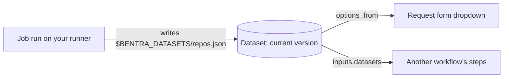

A **dataset** is a small table that a job publishes each time it runs successfully. Request forms use datasets for dropdown choices, and other workflows read them as inputs. When the source changes (a new team, a new repository), the next run of the job updates the dataset, and every form that reads it shows the new choices. Nobody edits YAML.



Your code runs only on your runners. Bentra stores the published rows and serves them to forms; it never runs code to build a dropdown.

## How it works

1. A job declares its datasets under `outputs.datasets` in `workflow.yml`, with the columns each one has.
2. Its steps write each dataset to `$BENTRA_DATASETS/<name>.json` as a JSON array of row objects.
3. After the steps succeed, the **Publish datasets** step uploads the files. Only successful runs publish.
4. If the data changed, Bentra stores it as a new **version** and makes it **current**. If nothing changed, the current version stays and only its refresh time is updated.
5. Forms and workflows that read the dataset always see the current version.

Run the job on a [schedule](/guides/workflow-status-and-schedules#schedules) to keep the data fresh.

## Limits

| | Limit |
|---|---|
| Datasets per job | 10 |
| Columns per dataset | 20 |
| Rows per dataset | 1,000 (set lower with `max_rows`) |
| Data per run, all datasets together | 1 MB |
| Versions kept per dataset | 20 (the current version is always kept) |

Values must be strings, numbers, booleans or null. See [`outputs`](/reference/workflow-syntax#outputs) for every rule.

<Warning>
Anyone who can open a form that reads a dataset can see its values. Never put secrets in a dataset.
</Warning>

## Example: a repository dropdown

A job lists your GitHub organization's repositories every hour. A request form offers them in a searchable dropdown.

<Steps>
<Step title="Give the job a GitHub token">
Steps don't get your connector's credentials, so a job that calls the GitHub API needs its own token. Create a [variable collection](/guides/variables-and-secrets) with a secret `GITHUB_TOKEN` and a plain `GITHUB_ORG`, and attach it to the job.
</Step>
<Step title="Write the job">
Create a job named **List org repos** (slug `list-org-repos`) with this `workflow.yml`:

```yaml
name: List org repos

outputs:
  datasets:
    repos:
      description: Repositories in the GitHub organization
      columns: [name, full_name, visibility, default_branch, archived, url]

steps:
  - name: List repositories
    run: |
      echo '[]' > all.json
      page=1
      while true; do
        curl -fsSL -H "Authorization: Bearer $GITHUB_TOKEN" \
          "https://api.github.com/orgs/$GITHUB_ORG/repos?per_page=100&page=$page" > batch.json
        if [ "$(jq length batch.json)" -eq 0 ]; then break; fi
        jq -s '.[0] + .[1]' all.json batch.json > merged.json && mv merged.json all.json
        page=$((page + 1))
      done
      jq '[.[] | {name, full_name, visibility, default_branch, archived, url: .html_url}]' \
        all.json > "$BENTRA_DATASETS/repos.json"
```
</Step>
<Step title="Run it once">
On the job's **Runs** tab, click **Trigger Run**. When the run succeeds, the job's **Datasets** tab shows `repos` with v1 and a preview of its rows.

The form in the next steps can only use the dataset after the job has run at least once, because that's when Bentra learns the dataset's columns.
</Step>
<Step title="Grant the form's workflow read access">
Create the request workflow (here, **Repository request**). Then open the **job's** **Settings → Data sharing**, click **Grant access**, pick **Repository request** and click **Grant access**.

If the request workflow is in another workspace, first widen the job's **Scope**. See [Who can read a dataset](#who-can-read-a-dataset).
</Step>
<Step title="Read the dataset in the form">
In the request workflow's `form.yml`, use `options_from` instead of `options`:

```yaml
name: Repository request
body:
  - type: dropdown
    id: repository
    attributes:
      label: Repository
      searchable: true
      options_from:
        job: list-org-repos
        dataset: repos
        value: full_name
        label: name
        where: {archived: false}
```

The dropdown shows each repository's `name`, submits its `full_name`, and leaves out archived repositories. Steps receive the choice as `$REPOSITORY`.
</Step>
<Step title="Keep it current">
In the job's **Settings → Job Settings**, turn on **Scheduled Runs** with `0 * * * *`. New repositories appear in the dropdown after the next hourly run.
</Step>
</Steps>

## Read datasets in a form

`options_from` works on `dropdown`, `checkboxes` and `radio` fields:

| Key | Meaning |
|---|---|
| `job` | The slug of the job that publishes the dataset. |
| `dataset` | The dataset name from the job's `outputs.datasets`. |
| `value` | The column submitted as the choice's value. |
| `label` | The column shown to people. Defaults to `value`. |
| `where` | Dropdowns only. Keep only rows whose columns match. A value can be a literal or `"{field_id}"`, another field's current value, for cascading dropdowns. |

- Bentra checks `options_from` when you save the form or publish a version: the job must exist, declare the dataset and the columns, and have granted your workflow read access.
- When someone submits the form, Bentra checks the chosen value against the current dataset. A value that is no longer in the dataset is rejected.
- Only the columns the form uses are sent to the browser.

See [`options_from`](/reference/form-syntax) in the form syntax for details and a cascading example.

## Read datasets in a workflow

Any workflow, job or request, can read other jobs' datasets as files. Declare them under `inputs.datasets`:

```yaml
inputs:
  datasets:
    - job: list-org-repos
      dataset: repos

steps:
  - name: Count active repositories
    run: jq '[.[] | select(.archived | not)] | length' "$BENTRA_INPUTS/list-org-repos/repos.json"
```

Before the first step, the runner downloads the current version of each dataset to `$BENTRA_INPUTS/<job>/<dataset>.json`. The workflow needs a read grant on each job, and each dataset must have been published; otherwise the run fails before any step runs. The setup log shows which version was loaded. See [`inputs`](/reference/workflow-syntax#inputs).

## Manage versions

Open the job's **Datasets** tab. Each dataset shows its columns, the current version and row count, when it was last refreshed, a preview of the rows, and a **History** of versions:

| Version status | Meaning |
|---|---|
| **Current** | What forms and workflows read now. |
| **Published** | An earlier version you can go back to. |
| **Held** | Published while the dataset was frozen. Not live until you make it current. |

### Roll back

Click **Make current** on an earlier version. Forms and workflows reading the dataset switch to that version right away.

Rolling back doesn't stop the job. Its next successful run with different data publishes a new version and makes it current again. To keep the old version in place, freeze the dataset as well.

### Freeze

Click **Freeze** to keep the current version in place:

- The job keeps running and uploading.
- Unchanged data only updates the refresh time.
- Changed data becomes a **Held** version. Readers keep seeing the current version.
- To publish a held version, click **Make current** on it.

Click **Unfreeze** to go back to normal. Held versions stay held; the next run with changed data publishes as usual.

Use freezing when the source system has bad data (freeze, roll back, fix the job), or to review changes before people see them (freeze, run, inspect the held version, make it current).

### Guard against empty data

If a run writes zero rows while the current version has rows, the run fails and nothing is published. This stops an outage in the source system from emptying every dropdown. Set `allow_empty: true` on the dataset if an empty result is legitimate.

A dataset the job no longer declares is shown as **Retired**.

## Who can read a dataset

Two settings, both on the job, decide which workflows can read its datasets. Find them in the job's **Settings → Data sharing**.

1. **Scope** (**Shareable with**): which workspaces' workflows can be granted access. **This workspace only** (the default), **Selected workspaces** or **All workspaces in the org**. Click **Save scope** after changing it.
2. **Read grants**: the workflows that may read the job's datasets. Click **Grant access** and pick a request or job workflow inside the scope.

- Data is never shared outside the organization.
- A job can always read its own datasets.
- Narrowing the scope **suspends** grants that fall outside it instead of deleting them. They come back if you widen the scope again.

On a request workflow, **Settings → Job data** lists the jobs it has been granted under **Reads from**.

Changing the scope, grants, versions or freezing needs the job's **Manage data sharing** permission, which workflow Admins and Writers have.

## API and MCP

Everything on this page is also available through the [Job datasets API](/reference/api/datasets) and the [MCP server](/ai/mcp-server): listing datasets and versions, promoting a version, freezing, and managing scope and grants.
