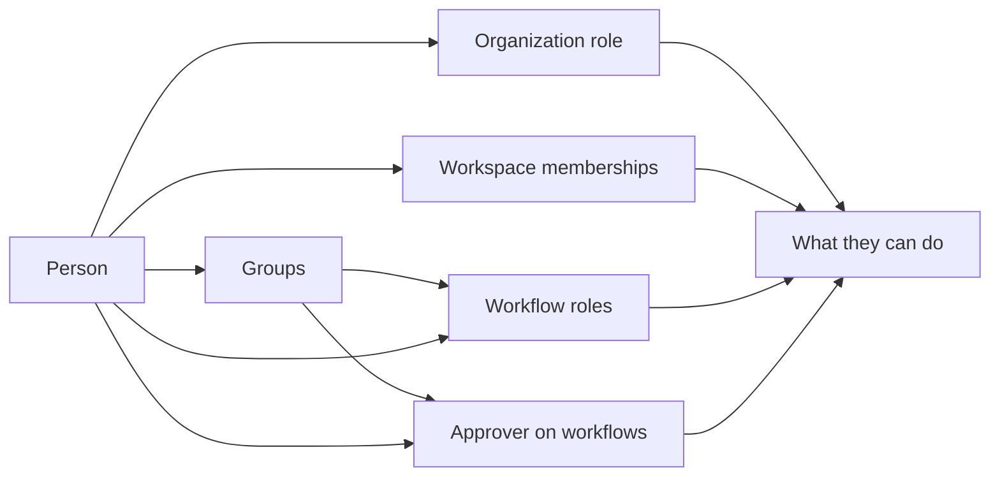
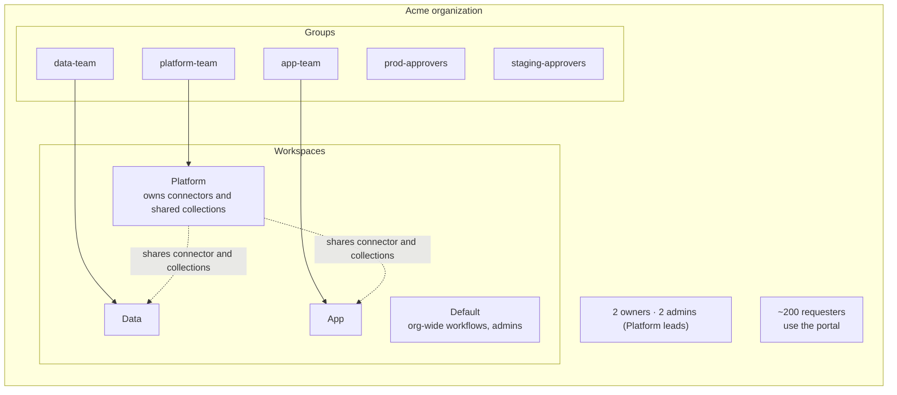
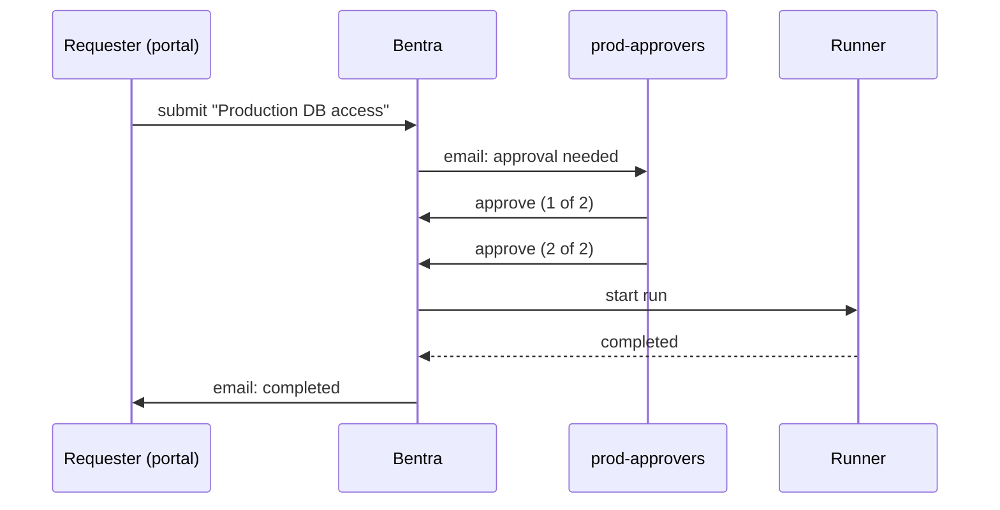
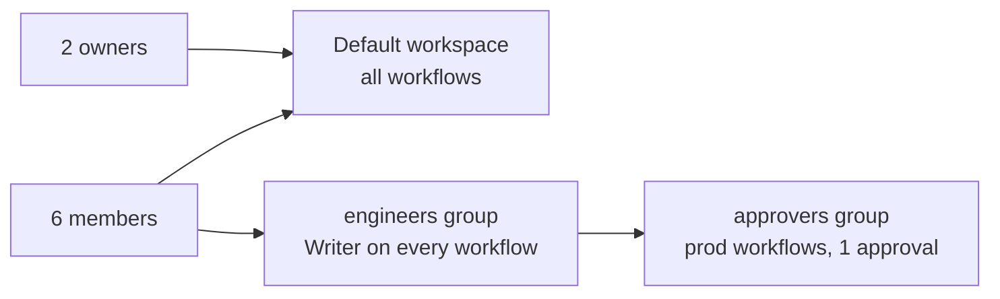

{/* Recommendations drafted for Connor's review */}

This page has two parts. [Part 1](#part-1-how-permissions-work) explains the permission model. [Part 2](#part-2-how-we-recommend-setting-up-bentra) is our recommendation for setting up a new organization, with two worked examples.

## Part 1: How permissions work

Four things decide what a person can do:

1. Their **organization role**: Owner, Admin, Member or Requester.
2. The **workspaces** they belong to.
3. Their **workflow roles**: Reader, Writer or Admin on individual workflows, given to them directly or through a group.
4. Whether they're a **designated approver** on a workflow, directly or through a group.

### Organization roles

Every person has exactly one organization role.

| | Owner | Admin | Member | Requester |
|---|:-:|:-:|:-:|:-:|
| Use the [request portal](/guides/request-portal) | Yes | Yes | Yes | Yes |
| Approve requests where designated | Yes | Yes | Yes | Yes |
| Create workflows and workspaces | Yes | Yes | Yes | |
| Open the workspaces they belong to | Yes | Yes | Yes | |
| Every workflow in every workspace, with all workflow permissions | Yes | Yes | | |
| Add connectors and variable collections | Any workspace | Any workspace | Workspaces they belong to, except the default one | |
| Manage runner pools | Yes | Yes | | |
| Invite and remove people, change roles | Yes | Yes, except owners | | |
| Create groups, manage any group | Yes | Yes | | |
| Rename, delete and manage members of any workspace | Yes | Yes | | |
| Billing, authentication (SSO) and portal branding | Yes | Yes | | |
| Grant, change or remove the Owner role | Yes | | | |
| Delete the organization | Yes | | | |
| Takes a seat | Yes | Yes | Yes | No |

An organization always keeps at least one owner. Requesters exist only on plans with the request portal.

### Workspaces

A workspace holds a team's workflows, forms, requests and runs, and owns connectors and variable collections. Being a member of a workspace lets someone open it, see its **Forms** list, and manage the connectors and variable collections it owns (see [Connectors](/reference/connectors) and [Variables and secrets](/guides/variables-and-secrets)).

- Every member except requesters gets a seat in the organization's **default workspace**.
- Whoever creates a workspace joins it as its owner. Organization owners and admins add and remove its members.
- Requesters can't join workspaces.

Workspace membership doesn't give access to every workflow in it. Inside a workspace, a member sees and works on the workflows they created and the ones they hold a workflow role on. Organization owners and admins see everything.

### Workflow roles

Whoever creates a workflow gets the **Admin** role on it. Give others access from the workflow's **Settings → Permissions**, with **Add Permission**, to a user or a group.

| Permission | Reader | Writer | Admin |
|---|:-:|:-:|:-:|
| View the workflow, its runs and its form | Yes | Yes | Yes |
| Edit files and settings | | Yes | Yes |
| Run it, submit its form, start held requests | | Yes | Yes |
| Form settings: approvers, notifications, portal | | Yes | Yes |
| Variables and attached collections | | Yes | Yes |
| Job dataset sharing | | Yes | Yes |
| Delete or archive it | | | Yes |
| Manage who has which role | | | Yes |
| [Skip approval](/guides/requests-and-approvals#skip-approval) through the API | | | Yes |

In the app, a person needs at least Reader on a workflow to open its form. Forms published to the portal don't need any role.

### Groups

A **group** is a named set of organization members. Each group has **owners** and **members**:

- Organization owners and admins create groups and can manage any group.
- A group's owners can add and remove its members and owners, rename it and delete it. The creator is the first owner, and a group always keeps at least one.

Groups are used in three places:

| Use | How membership is followed |
|---|---|
| **Workflow role** (Settings → Permissions → Add Permission → Group) | Live. Joining or leaving the group changes access straight away. |
| **Approver group** (Settings → Request Settings → Add Approver → Group) | Read when each request is submitted. People who join later approve later requests. |
| **Workspace members** (Settings → Members → Add Member → Group) | Copied once. The group's current members are added; people who join the group later need adding again. |

If your organization syncs groups from its identity provider through directory sync (SCIM, on Enterprise, rolling out), a synced group's members and name follow the IdP and can't be edited in Bentra. You can still use it for workflow roles and approvers.

### Approvers

Approval is separate from roles. Only a workflow's **designated approvers** can approve, reject or request changes on its requests, whatever their organization role. Approvers can be people or groups, and any member can be one, including requesters. See [Requests and approvals](/guides/requests-and-approvals).

### Form visibility

A request workflow's form settings decide who can find the form:

- **Workspaces**: **This workspace only**, **Selected workspaces** or **All workspaces in the org**, for the in-app **Forms** list.
- **Listed in Forms section**: off makes the form reachable by direct link only.
- **Show in request portal**: everyone in the organization can find and submit it from the portal.

### Requesters

Requesters are for the people who only ask for things: they use the portal, follow their own requests, and approve where designated. They don't take a seat. See [Request portal](/guides/request-portal).

## Part 2: How we recommend setting up Bentra

<Note>
This part is our recommendation, not a requirement. Adapt it to how your teams work.
</Note>

The principles:

- **Few owners and admins.** Owners and admins can do everything everywhere. Two owners is enough to avoid a lockout; keep admins to the people who run Bentra itself.
- **Workspaces per team, access per workflow.** A workspace groups a team's work; workflow roles decide who can change and run each workflow.
- **Groups, not individuals.** Grant roles and approval to groups, so access follows people when they join, move or leave.
- **Requesters for everyone else.** Most employees only need to ask for things. Make them requesters and publish forms to the portal.
- **Least privilege.** Reader by default, Writer for the people who maintain a workflow, Admin for its owners. Keep **Skip approval** for automation that genuinely needs it.

### Example: a 250-person company with three engineering teams

Acme has a Platform team (6 people), a Data team (8) and two App teams (20). Around 200 other employees request access and environments from time to time.

<Steps>
<Step title="Roles">
Make two people **Owners** and the Platform leads **Admins**. Everyone in the engineering teams is a **Member**. Everyone else is a **Requester**. With SSO, set [member provisioning](/authentication/setup-sso#3-member-provisioning) to **Add them as requester**, so new employees can use the portal the first time they sign in, and invite engineers as members.
</Step>
<Step title="Groups">
Create one group per team: `platform-team`, `data-team`, `app-team`. Add approval groups that cut across teams: `prod-approvers` (senior engineers from each team) and `staging-approvers`. Make each team lead an owner of their team's group so they manage membership themselves. If you use directory sync, mirror these groups from your IdP instead.
</Step>
<Step title="Workspaces">
Create **Platform**, **Data** and **App** workspaces, and add each team's group to its workspace from **Settings → Members → Add Member → Group**. Repeat that when people join a team. Keep the default workspace for organization-wide workflows that admins run, such as onboarding automation.
</Step>
<Step title="Shared infrastructure">
The Platform team owns the GitHub connector and the shared variable collections (cloud credentials per environment) in the **Platform** workspace, and shares them with **Data** and **App** so those teams can use them without being able to change them. Owners and admins manage the runner pools that the workflows run on.
</Step>
<Step title="Workflow roles">
On each workflow, give the owning team's group **Writer** and the team lead **Admin**. Give other teams **Reader** where they need to see runs.
</Step>
<Step title="Approvals per environment">
For workflows that change production, add `prod-approvers` as the approver group and set **Required Approvals** to 2, so someone other than the submitter always reviews. For staging, add `staging-approvers` with 1 required approval. For development, turn **Require Approvals** off.
</Step>
<Step title="Portal">
Publish the forms other employees need, such as access requests or a new sandbox, with **Show in request portal**. Put each under a clear category, brand the portal with your logo and colour, and share the portal link internally.
</Step>
</Steps>

How a production access request flows through this setup:

### Example: a small team with one workspace

A startup with 8 engineers on the Team plan doesn't need several workspaces.

- Two founders are **Owners**; everyone else is a **Member**. Skip admins.
- Use the **default workspace** for everything.
- Create an `engineers` group and give it **Writer** on each workflow, so new hires get access by joining the group.
- Create an `approvers` group of two or three senior engineers and make it the approver group on production workflows, with **Required Approvals** set to 1.
- If people outside engineering ask for things, invite them as **Requesters** and publish those forms to the portal.

## Related

- [Members and groups](/guides/members-and-groups)
- [Requests and approvals](/guides/requests-and-approvals)
- [Request portal](/guides/request-portal)
- [Administration API](/reference/api/administration) and [Workflow access API](/reference/api/workflow-access)
