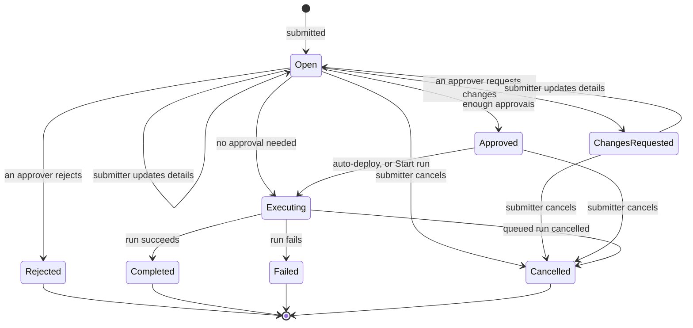

A **request** is one submission of a request workflow's form. Requests come from the workspace **Forms** list, the [request portal](/guides/request-portal) or the [API](/reference/api/requests). If the workflow needs approval, the request waits for its designated approvers. When it's approved, Bentra starts a [run](/guides/runs).

## The lifecycle

| Status | Meaning |
|---|---|
| **Open** | Submitted and waiting: for approvals, or for someone to start it. The API returns this status as `open`. |
| **Changes Requested** | An approver asked the submitter to change something. |
| **Approved** | It has enough approvals. With **Auto-deploy on Approval** off, it waits here for **Start run**. |
| **Executing** | Its run is queued or running. |
| **Completed** / **Failed** | The run finished. A request also fails if its run couldn't be started. |
| **Rejected** | An approver rejected it. This is final. |
| **Cancelled** | The submitter cancelled it before it ran, or its run was cancelled while still queued. |

A single rejection ends the request, whatever the other approvers decided. A request for changes sends it back to the submitter the same way.

## Set up approval

Approval settings live on the workflow. Open the workflow, then **Settings → Request Settings**. You need the Writer or Admin role on the workflow (see [Permissions](/guides/permissions)).

| Setting | What it does |
|---|---|
| **Require Approvals** | Submissions must be approved before they run. On by default. |
| **Required Approvals** | How many approvals a request needs, from 1 to 5. Any designated approvers count. |
| **Auto-deploy on Approval** | Start the run as soon as the last required approval arrives. On by default. |

With **Require Approvals** off, a request runs as soon as it's submitted. If **Auto-deploy on Approval** is also off, it stays **Open** until someone selects **Start run**.

<Warning>
If **Required Approvals** is higher than the number of designated approvers, requests can never be approved. With **Require Approvals** on and no approvers at all, requests stay **Open**.
</Warning>

### Designated approvers

Under **Designated Approvers**, select **Add Approver** and choose **User** or **Group**.

- **Users** are any members of the organization, including requesters.
- **Groups** add every direct member of the group. Members of nested groups aren't included. You can't add a group that has no members.

Bentra stores the group, not a copy of its members. Each request takes the group's members at the moment it's submitted, so people who join the group approve requests submitted after they joined, and people who leave stop being approvers on new requests.

The list on the page is the **effective** list: direct approvers first, then group members marked **via** their group. Someone who is both a direct approver and in an approver group appears once, as direct. Remove the group to take all its members off the list; remove a direct approver and, if they're also in an approver group, they stay on through the group.

To manage approvers from code, see [Workflow access](/reference/api/workflow-access#approvers).

## Who can do what on a request

| Action | Who |
|---|---|
| **Approve**, **Reject**, **Request Changes** | Designated approvers only, while the request is **Open**. Organization owners and admins can't decide unless they're designated approvers. |
| **Start run** | Designated approvers and anyone who can run the workflow (Writer or Admin), once the request is ready and not started. |
| Update details | The submitter, while the request is **Open** or **Changes Requested**. |
| **Cancel** | The submitter, while the request is **Open**, **Changes Requested** or **Approved** and not yet running. |
| Comment | Anyone who can see the request. |

Reject and Request Changes need a note explaining why. Approve takes an optional note.

<Note>
Bentra doesn't stop a designated approver from approving a request they submitted themselves, and that approval counts. To make sure someone else always reviews, set **Required Approvals** to 2 or more.
</Note>

In the app, the request page needs at least the Reader role on the workflow. Approvers without a role on the workflow can decide from the request portal's **Approvals** page (on plans that include the portal) or through the API.

## Request changes and resubmit

When an approver selects **Request Changes**, the request moves to **Changes Requested** and shows their note. The submitter selects **Update details** (in the portal) or sends the new answers through the [API](/reference/api/requests#patch-requestsid), and:

- the old answers are kept as a revision, and the activity shows which fields changed;
- approvals already given are cleared, because approvers need to review what will actually run;
- the request goes back to **Open** and the approvers are emailed again.

The submitter can also update an **Open** request before anyone decides, with the same effect.

## Comments and activity

The request page has an **Add Comment** box and an **Activity** feed. The feed lists everything that happened: submission, status changes, each approver's decision with their note, comments and revisions. Comments don't send email.

## Skip approval

Some automation needs to run a request workflow without waiting for people. A request submitted through the API with `"skip_approval": true` doesn't need approval and starts running immediately, whatever the workflow's approval settings.

This needs both:

- the **Skip approval** permission on the workflow, which comes with the workflow Admin role and with the organization owner and admin roles;
- an API token with the `skip:workflow_approval` scope. See [API tokens](/guides/api-tokens).

There's no way to skip approval from the form. Bentra records the bypass: the run page shows **approval bypassed** instead of who approved it. See [`POST workflows/{id}/submit/`](/reference/api/requests#post-workflowsidsubmit).

## Email notifications

Open the workflow, then **Settings → Notifications**. Each toggle is on by default.

| Toggle | Who gets the email |
|---|---|
| **On Submission** | The request's designated approvers, when a request that needs approval is submitted or updated. |
| **On Approval** | The submitter, when the request has enough approvals. |
| **On Rejection** | The submitter. |
| **On Completion** | The submitter, when the run succeeds. |
| **On Failure** | The submitter, when the run fails. |

**Also notify** adds extra recipients for one event, on top of the approvers and the submitter. Pick the event (**Request submitted**, **Request approved**, **Request rejected**, **Run completed** or **Run failed**), enter an email address and select **Add**. Any address works, inside or outside your organization, for example a team mailing list.

Bentra doesn't email when changes are requested or when someone comments. Job workflows have no submitter, so they email only the people under **Also notify**, when a run completes or fails.

Emails link to the request. A requester who opens the link lands on the request in the portal.

## Related

- [Request portal](/guides/request-portal)
- [Permissions and recommended setup](/guides/permissions)
- [Requests API](/reference/api/requests) and [Workflow access API](/reference/api/workflow-access)
