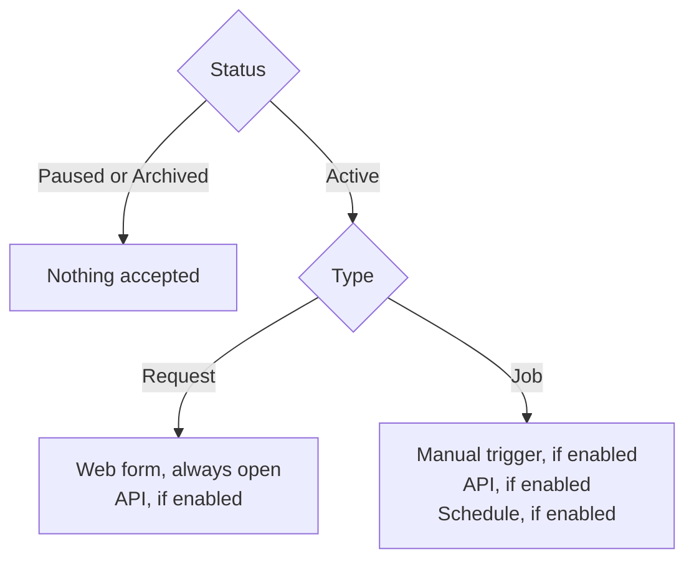

Three settings decide whether a workflow accepts new work:

1. **Status** is the master switch. Only an **Active** workflow accepts anything.
2. **Intake channels** choose how work can arrive while the workflow is Active: the form and the API for request workflows; manual triggers, the API and a schedule for jobs.
3. **Listing and visibility** choose who can find a request workflow's form.

## Status

Set the status in the workflow's **Settings → General → Status**. Status changes apply immediately; you don't need to click **Save**.

| Status | What it does |
|---|---|
| **Active** | Accepts requests or runs through the enabled intake channels. |
| **Paused** | Accepts nothing new. The form is hidden from the Forms list and the request portal, its direct link shows a closed page, and API calls are refused with `409`. Schedules are skipped. Settings stay editable. |
| **Archived** | Everything Paused does, plus the workflow becomes read-only and its name is freed for reuse in the workspace. Runs and requests stay visible. |

Requests and runs that already exist are not affected: a run that is already queued or running continues to completion.

The **Workflows** list has **All**, **Active**, **Paused** and **Archived** tabs. **All** doesn't include archived workflows.

### Who can change it

| Change | Permission | Workflow roles that have it |
|---|---|---|
| Active ↔ Paused | **Edit** | Admin, Writer |
| Archive, restore | **Delete** | Admin |
| Delete permanently | **Delete** | Admin |

See [Permissions](/guides/permissions) for how roles are granted.

### Archive, restore and delete

These are under **Settings → Destructive Actions**.

- **Archive** closes every intake channel and makes the settings read-only. Archived workflows don't count toward your plan's workflow limit.
- **Restore** sets an archived workflow back to Active. You can also restore from the **Archived** tab of the Workflows list. Restoring fails if another workflow in the workspace now uses the same name: rename or archive that one first. A restored workflow counts toward the workflow limit again (see [Plans and limits](/plans)).
- **Delete permanently** removes the workflow with its files, versions, requests, runs, logs and datasets. Type the workflow's name to confirm. It can't be undone. A repository the workflow reads from is not touched. Bentra refuses to delete a workflow while it has a queued or running run; cancel those first.

<Tip>
To stop a workflow but keep its history, archive it instead of deleting it.
</Tip>

## Intake channels

Intake channels only matter while the workflow is Active. Pausing is how you close a workflow; turning channels off is how you choose which doors are open.

<Tabs>
<Tab title="Request workflows">

| Channel | Where to turn it on or off |
|---|---|
| Web form | Always open while Active. Control who can find it with listing and visibility below. |
| API | **Settings → API → Accept API submissions** |

The API tab also shows the submit endpoint and the form's fields. See [API tokens](/guides/api-tokens) and the [Requests API](/reference/api/requests).

</Tab>
<Tab title="Jobs">

| Channel | Where to turn it on or off |
|---|---|
| Manual trigger | **Settings → Job Settings → Manual trigger**. Lets people start a run with **Trigger Run** on the workflow's **Runs** tab. |
| Schedule | **Settings → Job Settings → Scheduled Runs**. See [Schedules](#schedules). |
| API | **Settings → API → Allow API runs**. See the [Runs API](/reference/api/runs). |

If every channel is off, the Job Settings tab warns that nothing can start a run. Bentra allows it, but pausing the job says the same thing more clearly.

</Tab>
</Tabs>

On a new workflow, the API and manual trigger channels are on and the schedule is off.

<Note>
When your organization has used its plan's runs for the month, new requests and runs are refused on every channel until the month resets. See [Plans and limits](/plans).
</Note>

## Listing and visibility

For a request workflow, **Settings → Form Settings** controls who can find and submit the form:

- **Listed in Forms section**: shown in the Forms list. An unlisted form still works for anyone with its direct link. Use this to share a form with a few people without advertising it.
- **Show in request portal**: lists the form in the organization's request portal. See [Request portal](/guides/request-portal).
- **Workspaces**: **This workspace only**, **Selected workspaces** or **All workspaces in the org**. With **Selected workspaces**, add each workspace under **Visible In Workspaces** with **Viewer** (can view and submit the form) or **Editor** (can also edit the workflow) access.

The workflow's own **Form** tab is always available to its members while the workflow is Active, whatever these settings say. Turning the listing off hides the form from others while your team keeps working on it.

## Schedules

A job can run on a cron schedule. Bentra queues the run at each scheduled time and a runner in the job's pool picks it up, like any other run.

<Steps>
<Step title="Open Job Settings">
Open the job and go to **Settings → Job Settings**.
</Step>
<Step title="Turn on Scheduled Runs">
Turn on **Scheduled Runs**.
</Step>
<Step title="Enter a cron expression and timezone">
Enter a standard 5-field **Cron Expression**, for example `0 9 * * 1-5` for weekdays at 9 AM, and pick a **Timezone**.
</Step>
<Step title="Save">
Click **Save**. The settings page then shows the **Next run** time (in UTC) and when the schedule last fired.
</Step>
</Steps>

How schedules behave:

- **At most every 5 minutes.** A cron expression that fires more often is rejected.
- **No overlap.** If the job still has a queued or running run when a slot comes up, that slot is skipped.
- **No backfill.** Slots missed while the job was paused, or while its schedule was off, are not run later. The schedule continues from the next slot.
- **Paused and archived jobs** don't run on schedule. Resume the job and the schedule picks up at the next slot.
- **Plan limit.** Each plan allows a number of enabled schedules across the organization. At the limit you can't enable another until you turn one off. See [Plans and limits](/plans).

### Where scheduled jobs show up

- The workspace dashboard's **Scheduled jobs** table lists every enabled schedule with its cron expression and timezone, the next run, the last run and its status. A paused job shows **Paused** instead of a next run.
- Each scheduled run appears on the **Runs** page with **Scheduled** as its trigger. See [Runs](/guides/runs).

You can also set a schedule with the API: `schedule` in `PATCH workflows/{id}/settings/` in the [Workflows API](/reference/api/workflows).
